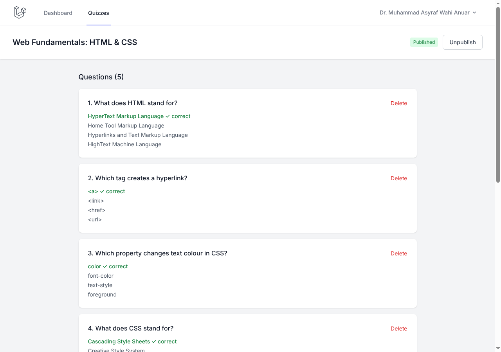
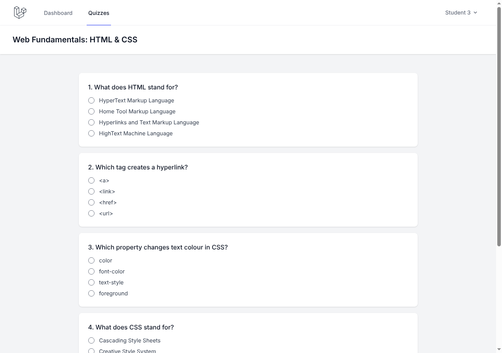
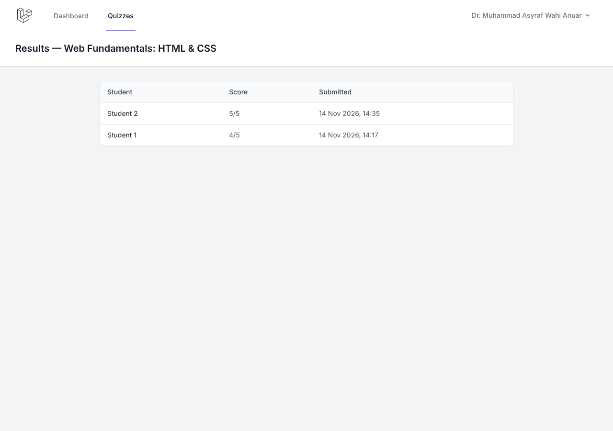

# Chapter 1 — Building Software by Directing, Not Typing

> **What you will learn:** what an agentic AI workflow is and how it differs from autocomplete; the five documents that turn a vague wish into instructions a machine can follow; what this book promises about reproducibility — and what it honestly cannot; and a first look at EduQuiz, the application you will build.

## 1.1 The shift

Ask a modern AI coding assistant to "add a login page" and something remarkable happens: it does not merely suggest a line of code. It opens files, writes new ones, runs commands in the terminal, reads the error messages, and tries again. This mode of working — where the AI plans and executes multi-step changes across a project while you supervise — is what this book means by **agentic AI**.

The earlier generation of AI tooling was *autocomplete*: you typed, it finished your sentence, and the next keystroke was always yours. Agentic tools invert the relationship. You describe an outcome; the agent produces the steps. The human contribution moves up a level, from writing code to three activities that now matter more than typing speed ever did:

1. **Specifying** — saying precisely what should exist, including what should *not* exist.
2. **Directing** — handing the agent work in pieces small enough to inspect.
3. **Verifying** — checking, every single time, that what came back is what was asked for.

If that sounds like the job description of a software architect, a project supervisor, or a lecturer marking submissions — yes. That is the point, and it is why educators take to this workflow faster than they expect. You already know how to set an assignment brief, scope the task, and mark the result. This book gives those instincts a technical harness.

## 1.2 Why a workflow, and not just a chat window

Anyone who has pasted "build me a quiz app" into a chatbot knows what comes back: an enthusiastic wall of code that almost runs, followed by an afternoon of debugging something you did not write and do not understand. The failure is not the model's capability. The failure is that the request carried almost no constraints, so the model filled the gaps with guesses — a different set of guesses every time.

The workflow in this book replaces the one big vague request with **five short documents**, each answering a question the agent would otherwise answer by guessing:

| Document | Question it answers | Chapter |
| --- | --- | --- |
| `PRD.md` | *What* are we building, for whom, and what is explicitly out of scope? | 7 |
| `Architecture.md` | *How* is it built — stack, database schema, routes, conventions? | 8 |
| `design.md` | What does it *look like* — layout, colours, components? | 9 |
| `AGENTS.md` | How must the agent *behave* — what is it forbidden to do? | 10 |
| `TODO.md` | In what *order* — one small task at a time, each with a check? | 11 |

Together they form a contract. The agent reads them before every task (most agentic tools read `AGENTS.md` automatically — it has become an industry convention), and every task in `TODO.md` is small enough that you can review its output in minutes. The documents are plain Markdown files, versioned in Git next to the code they govern, which means they serve three readers at once: you, your AI agent, and anyone who later wants to reproduce your work.

## 1.3 An honest promise: same outcome, not identical code

Here is the question every instructor asks first: *if thirty students follow this book, will they all get the same thing?*

The honest answer has two halves. No, they will not get identical code — large language models are non-deterministic, vendors swap the underlying models without notice, and the same prompt can produce a `QuizController` with the methods in a different order on Tuesday than it did on Monday. Any book that promises character-identical output from an AI agent will be broken by its first print run.

But yes — they will get the same *application*, and that is the promise this book makes and keeps. It is engineered into the method at four layers:

- **The documents constrain the shape.** With the database schema fixed in `Architecture.md` and extra packages forbidden in `AGENTS.md`, two very different-looking generations still produce the same tables, the same routes, the same behaviour.
- **Every task defines "done" functionally.** Each TODO item ends with a *Verify* line — "register one lecturer and one student; roles stored correctly" — that either passes or does not, regardless of how the code is phrased.
- **The environment is identical.** Docker pins PHP, MySQL, and Node to the same versions on every reader's machine (Chapter 5).
- **Checkpoints erase bad luck.** The companion repository carries a Git tag at every chapter boundary. A reader whose agent produced something unsalvageable runs `git switch -c from-ch13 chapter-13` and is standing on the book's own verified code, ready to continue (Chapter 6).

This re-framing — *reproducible outcome, not reproducible keystrokes* — is not a workaround. It is how professional teams already think about AI-assisted development, and learning to define "same" functionally is itself one of the durable skills this book teaches.

## 1.4 Meet EduQuiz

The project you will build is deliberately modest: **EduQuiz**, a web application in which lecturers create multiple-choice quizzes and students take them.

A lecturer registers, creates a quiz, adds questions — each with four options, one correct — and publishes it. A student registers, sees the published quizzes, takes one (once), and receives an automatic score. The lecturer sees a results table. That is the whole of it: five database tables, two roles, one question type.

The modesty is a design decision, made for three reasons. First, *you can judge correctness yourself*: everyone who has ever sat an exam knows what a quiz app should do, so when the agent's output is wrong, you will notice — which makes EduQuiz a safe place to practise the verifying half of the workflow. Second, *the domain is so conventional that agents converge on it*: a quiz schema is textbook material, which damps the variance between readers. Third, *everything cut from version one becomes your training ground*: timers, per-question review, more question types — Chapter 20 has you add them yourself, running the full workflow without the book holding your hand.

By the end you will have something real: an application you can seed with demo data, show in a classroom, deploy to ordinary web hosting (Chapter 19), and publish as an open educational tool under your own name.

## 1.5 What you need

- A computer that can run Docker Desktop (Windows 10/11, macOS, or Linux) with roughly 8 GB of RAM.
- Visual Studio Code, free, on any of those platforms.
- An AI agent in VS Code. The demonstrations use **GitHub Copilot agent mode** — free for verified teachers and students through GitHub Education, with a limited free tier for everyone else. **Cline**, an open-source alternative that works with free models, is fully documented in Appendix B. Setup for both is in Chapter 4 and the appendices.
- A free GitHub account.
- No prior Laravel or Tailwind knowledge. Chapters 2 and 3 teach you to *read* both, which is all the workflow requires.

> **A word to sceptics.** If you have programmed for years, the idea of not writing the code yourself may sit badly. Two answers. First, you remain the author of everything that matters — the data model, the rules, the acceptance criteria; the agent supplies only the mechanical translation. Second, try suspending judgment until Chapter 12, where you will see how a one-line verification step catches an agent's misreading of a task in less time than the feature would have taken to type. The discipline is the product; the agent is just labour.

## 1.6 The road from here

Chapter 2 teaches you to read the server side of the application — Laravel — and Chapter 3 the visual side, Tailwind. Neither aims to make you a writer of either; both aim to make you a confident *reviewer*, because a reviewer is what this workflow needs. Then the workbench (Part II), the five documents (Part III), the build itself (Part IV), and shipping (Part V).

One chapter from now, you will trace what happens when a browser asks EduQuiz for a page. By Chapter 5, EduQuiz's skeleton will be running on your own machine. By Chapter 17 it will be scoring quizzes. The distance between here and there is shorter than it has ever been in the history of web development — provided you learn to direct.
