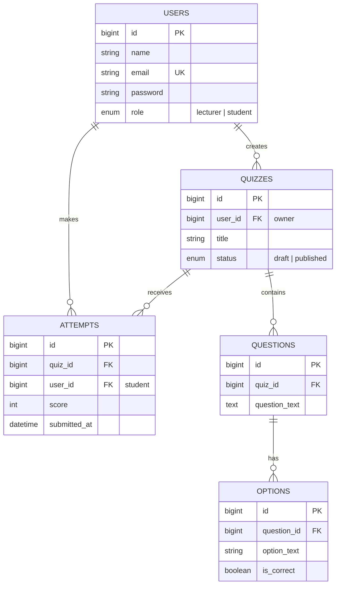

# Chapter 8 — Architecture.md: How It Is Built

> **What you will learn:** how to pin a technology stack so agents cannot drift from it; how to design a database schema and express it as a Mermaid ERD that serves you, your agent, and GitHub at once; how a routes table becomes a complete map of the application; and which conventions are worth writing down.

## 8.1 Decisions the agent must not make

If the PRD answers *what*, `Architecture.md` answers *how* — and in an agentic workflow, its job is mostly to remove choices. Left to itself, an agent will pick a stack, invent a schema, name routes, and choose where validation lives, re-deciding each on every task. Even if every individual choice were good, they would not be *consistent*, and inconsistency is what makes a codebase unreviewable.

So this document is a list of decisions already made. It has four sections: stack, data model, routes, conventions.

## 8.2 The stack, pinned

```markdown
| Layer            | Choice                      | Notes                                   |
| ---------------- | --------------------------- | --------------------------------------- |
| Language         | PHP 8.3                     | fixed by the Docker image               |
| Framework        | Laravel 13                  | exact version pinned in composer.lock   |
| Database         | MySQL 8.0                   | service `db` in Docker Compose          |
| Views            | Blade templates only        | no React, Vue, Livewire, Inertia, or API endpoints |
| CSS              | Tailwind CSS via Vite       | utilities only; no custom CSS files     |
| Auth scaffolding | Laravel Breeze, Blade stack | verified: Breeze 2.4 installs on Laravel 13 |
| Environment      | Docker Compose              | readers never edit the compose file     |
```

The *Notes* column does the real work. "Blade templates only" would be ambiguous; listing the alternatives the agent might reach for — React, Vue, Livewire, Inertia — closes them by name. Agents respond far better to explicit exclusions than to inferred ones.

> **A finding from the validation build.** This table originally said *Laravel 12*. By the time the build ran, the current release was 13, and `composer create-project` installed it. Nothing broke, but the document was wrong, and a wrong document teaches the agent to distrust its documents. The fix took one line. The lesson is general: **pin versions to what you actually verified**, record where the exact pin lives (`composer.lock`), and update the document the moment reality moves.

## 8.3 The data model: designing the schema

The schema is the single most consequential decision in the application. Everything else — controllers, views, validation — is shaped around it, and it is the hardest thing to change later. Design it by hand, deliberately, before any agent runs.

EduQuiz needs five tables. Here is the reasoning for each, in the order you would discover them:

1. **users** — Laravel provides this table; we add one column, `role`, an enum of `lecturer` or `student` (PRD: *exactly one role*).
2. **quizzes** — owned by a lecturer, so it carries `user_id`. It has a `title` and a `status` enum of `draft` or `published` (FR-3, FR-5).
3. **questions** — belong to a quiz (`quiz_id`), with `question_text`.
4. **options** — belong to a question (`question_id`), with `option_text` and an `is_correct` boolean. Four rows per question; exactly one has `is_correct` set to true (FR-4).
5. **attempts** — one student's single attempt at one quiz: `quiz_id`, `user_id`, a `score` stored as an integer, and `submitted_at`.

What is *not* here is as instructive. There is no `answers` table recording which option a student chose. The score is computed at submission and stored as one number. That is a deliberate simplification: per-question review is out of scope (PRD), and leaving it out removed the trickiest table in the original design. Chapter 20 asks you to add it back, at which point you will understand exactly why it was trickier.

## 8.4 The ERD in Mermaid: one artefact, three readers

The schema is recorded in `Architecture.md` as a **Mermaid** entity-relationship diagram — a diagram written as text:



Read the relationship lines like sentences. `USERS ||--o{ QUIZZES : creates` means *one user creates zero or more quizzes*: the `||` marks exactly one on the user's side; the `o{` marks zero-or-many on the quiz's side. Each table block lists columns with type, name, and markers: `PK` for primary key, `FK` for foreign key, `UK` for unique.

Why text rather than a drawing tool? Because this one artefact serves three readers:

- **You** — GitHub renders Mermaid automatically, so the file displays as a proper diagram (Figure 8.1).
- **The agent** — it reads the text directly and turns it into migrations. A picture in a PNG would be far less reliable for this.
- **Git** — when the schema changes in Chapter 20, the diff shows exactly which line changed. A binary image would show only "file modified."


Below the diagram, two sentences finish the data model:

```markdown
All foreign keys cascade on delete. `attempts` has a unique index on
(`quiz_id`, `user_id`) — the database enforces one attempt per student.
```

The first settles what happens to questions, options, and attempts when a quiz is deleted: they go with it. The second is subtler and worth a concept box.

> **Concept box: enforce rules at the lowest layer you can.** FR-9 (one attempt per student) could be enforced only in the controller: *check whether an attempt exists; if so, refuse.* But a controller check can be bypassed — by a double-click that sends two requests at once, by a future feature that forgets to check. A unique index makes the database itself refuse a second row for the same quiz and student. The controller check stays, because it gives the student a friendly message; the index is the guarantee. When you write requirements into Architecture.md, ask for each rule: *can the database enforce this?*

The section opens with the strongest sentence in the document: *"No other tables or columns may be created."* That single line, reinforced in `AGENTS.md`, is why every reader's database matches every other reader's exactly.

## 8.5 Routes: the application's complete map

```markdown
| Method   | URI                           | Name                    | Access                              |
| -------- | ----------------------------- | ----------------------- | ----------------------------------- |
| GET      | /dashboard                    | dashboard               | both (role-aware view)              |
| GET      | /quizzes                      | quizzes.index           | lecturer: own; student: published   |
| GET/POST | /quizzes/create, /quizzes     | quizzes.create / .store | lecturer                            |
| GET      | /quizzes/{quiz}               | quizzes.show            | lecturer (own): manage view         |
| PATCH    | /quizzes/{quiz}/publish       | quizzes.publish         | lecturer, own quiz; toggles status  |
| POST     | /quizzes/{quiz}/questions     | questions.store         | lecturer, own quiz                  |
| GET      | /quizzes/{quiz}/take          | quizzes.take            | student, published, not attempted   |
| POST     | /quizzes/{quiz}/attempts      | attempts.store          | student, published, not attempted   |
| GET      | /quizzes/{quiz}/results       | quizzes.results         | lecturer, own quiz                  |
```

*(Abridged here; the full twelve-row table is in Appendix D.)*

A routes table is the cheapest architecture document you can write, and among the most valuable. Every page and every action in the application appears as one row, so the table is simultaneously the sitemap, the API, and the access-control specification. The **Access** column is the important one: it states, per route, who may enter and under what conditions — the raw material for the authorization code the agent will write.

It also gives you a mechanical review check. After any task, `php artisan route:list` prints the routes that actually exist; compare the output with this table, row by row, and drift becomes visible immediately.

## 8.6 Conventions: the small decisions

```markdown
- Controllers: QuizController, QuestionController, AttemptController;
  validation inline in controller methods
- Authorization: a QuizPolicy for ownership checks
- Models singular (Quiz, Question, Option, Attempt); tables plural
- Seeding: DatabaseSeeder creates 1 lecturer, 5 students, 2 quizzes
```

Conventions settle the choices that matter little individually and a great deal collectively. Should validation live in a separate Form Request class or inline in the controller? Both are respectable Laravel. But if task T5 uses one and task T6 the other, a reviewer meets two patterns for one job. Pick one, write it down, move on. EduQuiz picks *inline*, because in a small application it keeps each feature readable in a single file.

Naming controllers in advance has a second benefit: the agent builds on the same files task after task rather than spawning a `QuizManagementController` on Tuesday next to Monday's `QuizController`.

## 8.7 Checklist for your own Architecture.md

- [ ] Stack table with every layer pinned, and named exclusions in the Notes column
- [ ] ERD in Mermaid; every table and column the application will ever have
- [ ] Cascade and uniqueness rules stated in prose beneath the diagram
- [ ] "No other tables or columns" sentence
- [ ] Routes table with an Access column
- [ ] Conventions: controller names, where validation lives, authorization approach, seeding plan

The application now has a purpose (PRD) and a skeleton (this document). Next it needs a face.
