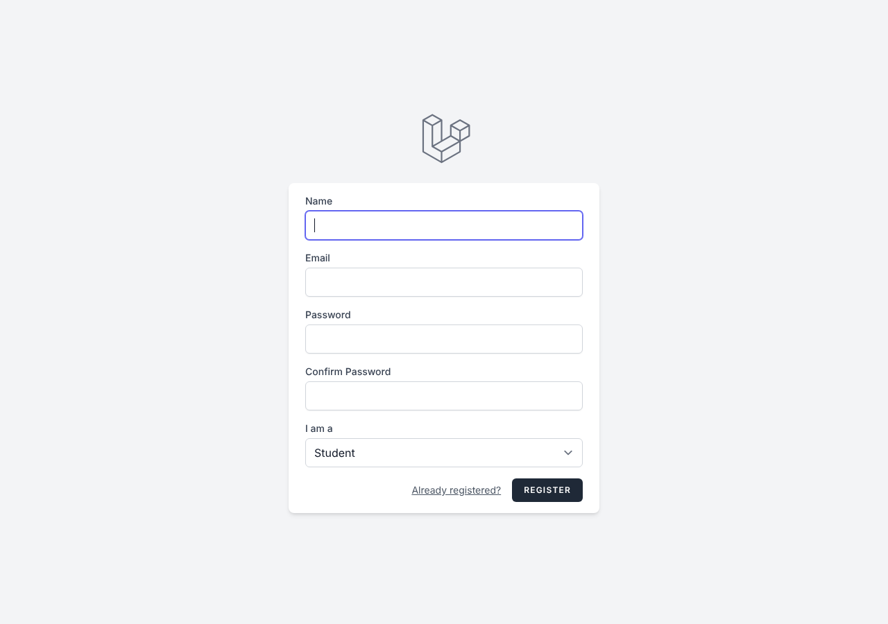
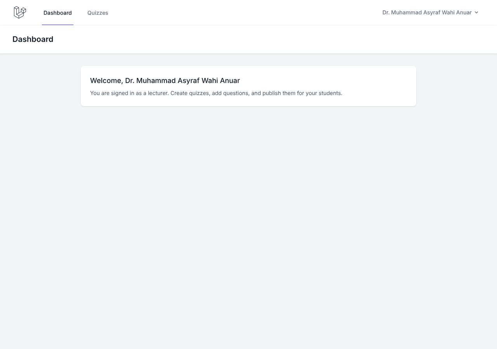

# Chapter 12 — Authentication and Roles

> **Tasks:** T1–T3 · **Implements:** FR-1, FR-2 · **Ends at tag:** `chapter-12`
>
> **What you will learn:** the build loop in practice, from first prompt to first commit; how scaffolding packages give you tested features for free; what to do when a change breaks an existing test; and how to recognise, and respond to, an agent that is going wrong.

## 12.1 The loop, one last time on paper

From this chapter to Chapter 17, every task follows the same five steps:

1. **Prompt.** Give the agent one task by its identifier.
2. **Watch.** Approve or question each step it proposes.
3. **Review.** Read its report, then `git status` and `git diff`.
4. **Verify.** Perform the task's verify line yourself.
5. **Commit** — or **discard** with `git restore .` and try again.

Before starting, check your workbench: the Docker stack is running (`docker compose up`), `localhost:8000` shows the welcome page, and `git status` shows a clean tree on your `my-build` branch.

## 12.2 The prompt

Open your agent's panel and type, for the first time, the sentence you will type fourteen times in this book:

```text
Read AGENTS.md and the documents in docs/. Complete task T1 from docs/TODO.md.
```

That is the whole prompt. Everything else the agent needs is already in the documents. Resist the urge to add detail here: if the task needs more information, the right place for it is `TODO.md`, where it is versioned and applies to every reader. A prompt that grows long is a sign the documents have a gap.

## 12.3 T1 — Install Laravel Breeze

> **T1** Install Laravel Breeze (Blade stack); run its install and migrations. *Verify: register, log in and log out at /login.*

Breeze is Laravel's official starter kit for authentication. It generates registration, login, logout, password reset, and profile pages, with their controllers, views, routes, and tests. T1 is the only task in the book that installs a package, and it is allowed to because the task names it (AGENTS.md rule 2).

Expect the agent to propose something close to this sequence, which is what the validation build ran:

```bash
docker compose exec app composer require laravel/breeze --dev
docker compose exec app php artisan breeze:install blade
docker compose exec app php artisan migrate
```

Approve each step. The second command generates dozens of files, so the diff for T1 is large. That is the exception, not the rule: **review a scaffolding task by trusting the scaffold and checking its edges.** Confirm that the new files are under `app/Http/Controllers/Auth/`, `resources/views/auth/`, and `tests/Feature/Auth/`; that `routes/auth.php` exists; and that nothing touched `docker-compose.yml` or `.env`.

> **Concept box: tests you did not write.** Breeze installs about 25 feature tests covering registration, login, logout, password confirmation, and profile updates. Run them:
>
> ```bash
> docker compose exec app php artisan test
> ```
>
> Every one should pass. These tests become a safety net for the rest of the build: any later task that accidentally breaks authentication will turn one of them red. Expect around 25 passing tests at the end of T1.

Now do the verify line yourself. Visit `localhost:8000/register`, create an account, log out, and log in again. If all three work:

```bash
git add -A
git commit -m "T1: install Laravel Breeze (Blade stack)"
```

## 12.4 T2 — Add roles

> **T2** Add `role` enum (`lecturer`, `student`) to users via migration; add a role select to the registration form. *Verify: register one lecturer and one student; roles stored correctly, and `php artisan test` still passes (Breeze's registration test needs the new role field).*

Prompt with "Complete task T2." This task touches four places, and you will see them in the report: a new migration, the registration view, the registration controller, and the `User` model's list of fillable fields.

The core of the diff, which you saw in Chapter 6, adds `role` to the controller's validation and to the user it creates. Check the validation rule against the ERD: `'role' => ['required', 'in:lecturer,student']` must list exactly the two enum values.

The registration page should then look like Figure 12.1.



> **When the AI gets it wrong: the test that broke.** During the validation build, T2 worked in the browser but turned one of Breeze's tests red. `RegistrationTest` submits the form without a role — it was written before roles existed — and the new validation rule now rejects it.
>
> This is not the agent's mistake, nor the test's. It is what happens whenever you add a required field to a form that has a test. The fix is one line in the test: add `'role' => 'student'` to the data it submits. The original verify line for T2 did not mention tests, so an agent could report "done" with a red suite. The revised line makes `php artisan test` part of the check.
>
> **The general lesson:** run the full test suite after every task, not only the tests you think are related. A red test after a change is the system telling you something; read it before you dismiss it.

Verify: register a lecturer and a student, then confirm in the database that the roles were stored:

```bash
docker compose exec app php artisan tinker --execute="echo App\Models\User::pluck('role','email');"
```

All tests green, both roles correct: commit with the message `T2: add role to users and registration`.

## 12.5 T3 — Role-aware dashboards

> **T3** Role-aware dashboard: different welcome text and guidance per role (quiz counts arrive with later tasks). *Verify: both accounts see different dashboards.*

This is the smallest task in the chapter: one Blade view with an `@if` on the user's role. The validation build's version was ten lines of content. Log in as each of your two users; the lecturer should see something like Figure 12.2, and the student a different message.



> **When the AI gets it wrong: the task that could not be done.** T3 originally asked for *quiz counts* on each dashboard. Quizzes are created in T4. An agent cannot count rows in a table that does not exist, and AGENTS.md forbids it from creating that table early.
>
> A well-behaved agent stops and says so (rule 11). A less disciplined one might create a `quizzes` migration on the spot, quietly duplicating work T4 will do, or write code that crashes when the dashboard loads. Either outcome would show in your review: a migration file in a task that should have none, or a red page at verification.
>
> The task has since been rewritten (Chapter 11, §11.5). If you are using an older copy of the roadmap and your agent asks about the missing table, it is doing exactly what it should. Answer it, and fix the task in `TODO.md` so the next reader is not asked the same question.

Verify, commit as `T3: role-aware dashboards`, and tag the chapter:

```bash
git tag my-chapter-12
```

## 12.6 Recognising an agent that is going wrong

You will usually get clean runs. But since this is the first build chapter, here are the common signs that a run is going off course:

- **It edits files the task does not mention.** Stop it and ask why.
- **It proposes installing a package the task did not name.** Refuse; rule 2.
- **It fixes a failing command by editing configuration.** Refuse; rule 7. The environment is known-good.
- **It runs in circles**: the same error, a different fix, the same error again. Three rounds is the limit. Stop, discard (`git restore .`), and restart the task in a fresh agent session.
- **Its report claims success but your verification fails.** Discard and retry. Do not try to patch a failed task in place by chatting; that is how small tasks become large ones.

A fresh session plus a clean working tree is the most reliable fix for a confused agent. Starting over costs a few minutes; untangling a confused session can cost an hour.

## 12.7 Checkpoint

> **Checkpoint — `chapter-12`.** You can register as a lecturer or a student, log in, and see a role-specific dashboard. `php artisan test` reports about 25 passing tests.
>
> If your build differs and you cannot repair it, discard your changes and continue from the book's verified state:
>
> ```bash
> git restore .
> git switch -c from-ch12 chapter-12
> ```

The application has users who know who they are. In the next chapter, lecturers get something to manage.
