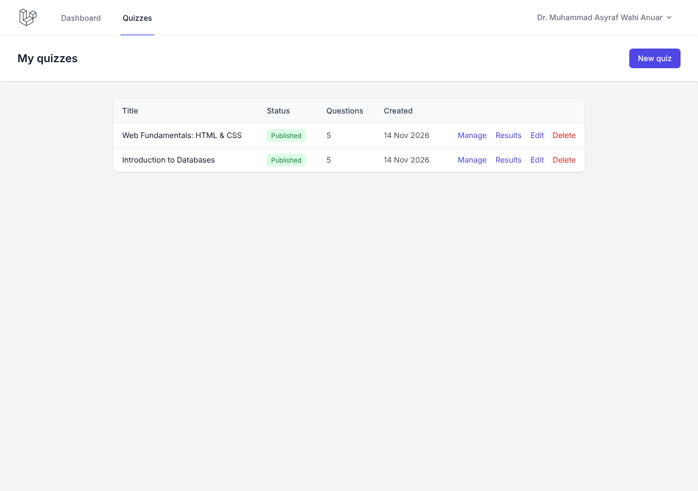

# Chapter 13 — Quiz CRUD for Lecturers

> **Tasks:** T4–T5 · **Implements:** FR-3, FR-11 · **Ends at tag:** `chapter-13`
>
> **What you will learn:** how to review a migration against the ERD; what a policy is and why ownership checks belong in one; how to test authorization by trying to break it; and why a chapter must never end with a broken link.

## 13.1 Where we are

Users can register and log in, and each sees a dashboard for their role. This chapter gives lecturers their first real feature: creating, renaming, and deleting quizzes. It also introduces the application's first serious security question — *can lecturer A touch lecturer B's quiz?* — and answers it.

## 13.2 T4 — The Quiz model, policy, and list

> **T4** `Quiz` model, migration (per ERD), `QuizPolicy`, and quiz list page showing the lecturer's own quizzes. *Verify: lecturer sees an empty list; student is blocked from /quizzes/create.*

Prompt: "Complete task T4." Expect the agent to generate files with artisan — `make:model Quiz -m` and `make:policy QuizPolicy` — and then fill them in.

### Reviewing the migration

The migration is the first thing to check, because it is the hardest thing to change later. Open it beside the ERD in `Architecture.md` and compare line by line:

```php
Schema::create('quizzes', function (Blueprint $table) {
    $table->id();
    $table->foreignId('user_id')->constrained()->cascadeOnDelete();
    $table->string('title');
    $table->enum('status', ['draft', 'published'])->default('draft');
    $table->timestamps();
});
```

Four columns from the ERD (`id`, `user_id`, `title`, `status`), plus Laravel's timestamps, which `Architecture.md` permits by convention. The foreign key cascades on delete, as the prose under the ERD requires. Nothing extra: no `description`, no `slug`, no `is_active`. If your agent's migration has an extra column, that is a rule 4 violation. Ask it to remove the column, or discard and rerun.

### Reviewing the policy

A **policy** is a class that answers "may this user do this to this thing?" EduQuiz's is short:

```php
class QuizPolicy
{
    public function create(User $user): bool
    {
        return $user->role === 'lecturer';
    }

    public function manage(User $user, Quiz $quiz): bool
    {
        return $user->role === 'lecturer' && $quiz->user_id === $user->id;
    }
}
```

Two rules, each a single line. `create` admits lecturers only. `manage` admits a lecturer only for their own quiz. Every quiz-changing action in the application will call one of these two methods, so the security of the whole feature reduces to these two lines.

> **Concept box: why a policy, not an `if` in each controller?** You could write `if ($quiz->user_id !== $user->id) abort(403);` at the top of every method. It works until someone forgets it on one method. A policy puts the rule in one place, and each controller method asks for it in one line: `Gate::authorize('manage', $quiz)`. When you review, you check the policy once and then confirm each method calls it. Chapter 10's rule 5 names `QuizPolicy` for exactly this reason.

### Verify by trying to break it

The verify line has a positive and a negative check. The positive: log in as your lecturer and visit `/quizzes` — an empty list with a *New quiz* button. The negative: log in as your student and type `localhost:8000/quizzes/create` directly into the address bar. You should get a **403 Forbidden** page.

Do not skip the negative check. A missing authorization check is invisible on the happy path, because nothing in the interface links a student to that URL. The only way to find it is to try the door yourself.

Commit: `T4: Quiz model, policy, and lecturer quiz list`.

## 13.3 T5 — Create, edit, delete

> **T5** Create, edit and delete quizzes (title only; status defaults to draft), plus a minimal manage page (title + status badge; questions arrive next chapter). *Verify: lecturer creates, renames, deletes a quiz; Manage opens without error; another lecturer's quiz returns 403.*

T5 adds the full set of controller actions, a create form, an edit form, and the manage page shell. Each controller method should begin with an authorization call, as in this method from the validation build:

```php
public function update(Request $request, Quiz $quiz)
{
    Gate::authorize('manage', $quiz);

    $validated = $request->validate([
        'title' => ['required', 'string', 'max:255'],
    ]);

    $quiz->update($validated);

    return redirect()->route('quizzes.index')->with('success', 'Quiz updated.');
}
```

Read it in three beats: *authorize, validate, act.* Every method that changes data in EduQuiz has this shape. When you review T5's controller, check that `create`, `store`, `edit`, `update`, `destroy`, and `show` each start with `Gate::authorize`. One missing call is one open door.

> **When the plan gets it wrong: the Manage link to nowhere.** The original T5 built the quiz list with a *Manage* link on each quiz, but left the manage page for the next chapter. During validation, Chapter 13 would therefore have ended with a link that crashed. That breaks the book's central promise that every chapter ends with a working application.
>
> The rewritten T5 includes a minimal manage page: just the quiz title and its status badge, with a note that questions come next. Chapter 14 fills it in. If you write your own roadmaps, check every link and button that a task creates: **does its destination exist by the end of the same chapter?**

> **Watch for stale CSS.** T5 creates several new views with new Tailwind classes. If your `node` container is not running — or if you are working outside Docker — the new classes are not in the CSS bundle and pages render oddly: buttons lose their colour, layouts collapse. Chapter 3 described exactly this failure from the validation build. Check `docker compose ps` for a running `node` service, or run `npm run build` once.

### Verify with two lecturers

The full check needs a second lecturer account:

1. As lecturer A, create a quiz, rename it, and confirm the new title appears in the list.
2. Click *Manage*; the page should open without error, showing the title and a *Draft* badge.
3. Note the quiz's number in the address bar, for example `/quizzes/1/edit`.
4. Register lecturer B, log in, and visit `/quizzes/1/edit`. You should get 403.
5. As lecturer A again, delete the quiz.

Figure 13.1 shows the quiz list as it looks once the build is complete and seeded (Chapter 17); at this stage yours will show only the quizzes you created, without question counts.



Step 4 is the one that matters. Rule 5 asked for it, the policy implements it, and now you have seen it work.

Commit: `T5: quiz create, edit, delete and manage page`.

## 13.4 Checkpoint

> **Checkpoint — `chapter-13`.** Lecturers can create, rename, and delete their own quizzes, and open a minimal manage page for each. Students cannot reach any quiz-management URL. One lecturer cannot touch another's quizzes.
>
> ```bash
> git tag my-chapter-13
> ```
>
> To continue from the book's verified state instead: `git restore . && git switch -c from-ch13 chapter-13`.

Quizzes exist, but they are empty shells. Next, they get questions.
