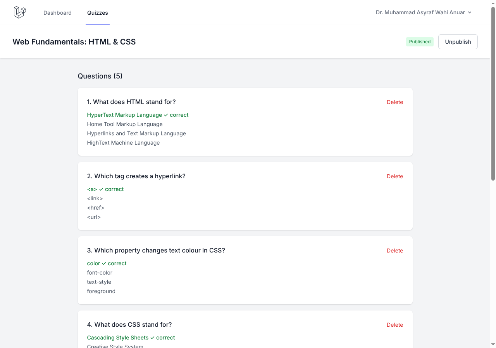

# Chapter 14 — Questions and Options

> **Tasks:** T6–T7 · **Implements:** FR-4 · **Ends at tag:** `chapter-14`
>
> **What you will learn:** how a form submits a set of related records at once; why such writes belong in a database transaction; how validation enforces a business rule like "exactly four options, exactly one correct"; and how cascading deletes clean up after themselves.

## 14.1 Where we are

Lecturers can create quizzes, but each quiz is a title and nothing else. This chapter adds the content: questions, each with four options, one correct. It is the largest task in the book (T6) followed by one of the smallest (T7), and it is the first time a single form creates records in two tables at once.

## 14.2 T6 — Questions, options, and the add form

> **T6** `Question` and `Option` models + migrations (per ERD); add-question form on the quiz manage page (text, 4 options, radio marks the correct one) with validation. *Verify: add a question; exactly 4 options saved, one correct.*

Prompt: "Complete task T6." Expect two migrations, two models, a `QuestionController`, a route, and an expanded manage page. Review the migrations against the ERD as in Chapter 13: `questions` has `quiz_id` and `question_text`; `options` has `question_id`, `option_text`, and `is_correct`. Both foreign keys cascade on delete.

### One form, five records

The add-question form submits one question and four options together. In the browser it is a text area and four text fields, each with a radio button to mark the correct one. In the request it arrives as:

```text
question_text = "What does HTML stand for?"
options[0]    = "HyperText Markup Language"
options[1]    = "Home Tool Markup Language"
options[2]    = "Hyperlinks and Text Markup Language"
options[3]    = "HighText Machine Language"
correct       = 0
```

The square brackets in `options[0]` tell PHP to collect the four fields into an array. The radio buttons all share the name `correct`, so only one value can be sent — the browser itself enforces "exactly one correct" in the form. But a browser is not a guarantee, which brings us to validation.

### Validation as a business rule

From the validation build's `QuestionController`:

```php
$validated = $request->validate([
    'question_text' => ['required', 'string'],
    'options'       => ['required', 'array', 'size:4'],
    'options.*'     => ['required', 'string', 'max:255'],
    'correct'       => ['required', 'integer', 'between:0,3'],
]);
```

Read each rule against FR-4. `options` must be an array of exactly four (`size:4`). Each option (`options.*`) must be a non-empty string. `correct` must be a whole number from 0 to 3, so it always points at one of the four options. Together these four lines *are* the business rule "exactly four options, exactly one correct", enforced on the server where a modified form or a script cannot bypass it.

### All or nothing: the transaction

The controller then saves five rows: one question, four options. Here is the core of it:

```php
DB::transaction(function () use ($quiz, $validated) {
    $question = $quiz->questions()->create([
        'question_text' => $validated['question_text'],
    ]);

    foreach ($validated['options'] as $index => $text) {
        $question->options()->create([
            'option_text' => $text,
            'is_correct'  => $index === (int) $validated['correct'],
        ]);
    }
});
```

> **Concept box: transactions.** What if the database failed after saving the question and two options? You would have a question with two options, breaking FR-4 permanently. `DB::transaction` wraps the five writes so that either all of them succeed or none do. If anything inside the function throws an error, the database rolls back to how it was before. Whenever one user action writes several related rows, look for a transaction in the agent's code. If it is missing, ask for one.

Notice also the line that sets `is_correct`. It compares each option's position with the submitted `correct` number, so exactly one option gets `true`. This is how the radio button becomes data.

### Verify

As a lecturer, open a quiz's manage page and add a question. Then check the database directly:

```bash
docker compose exec app php artisan tinker --execute="echo App\Models\Option::count().' options, '.App\Models\Option::where('is_correct',true)->count().' correct';"
```

For one question you should see `4 options, 1 correct`. Then try the negative case: in your browser's developer tools, delete two of the option fields from the form and submit. The page should come back with a validation error, not a saved question.

Commit: `T6: questions and options with add form`.

## 14.3 T7 — Listing and deleting questions

> **T7** List questions on the manage page as numbered cards with the correct option marked; allow deleting a question. *Verify: two questions display in order; deleting removes its options too.*

T7 is presentation plus one action. Each question appears as a card with its options, the correct one highlighted in green, and a *Delete* link. Figure 14.1 shows the result with seeded data.



Review the delete action for authorization. A question does not have an owner of its own, so the controller must check ownership through its quiz:

```php
public function destroy(Question $question)
{
    Gate::authorize('manage', $question->quiz);
    // ...
}
```

`$question->quiz` follows the relationship from Chapter 2 back to the parent quiz, and the existing `manage` policy does the rest. No new policy is needed — a good sign that Chapter 13's design was right.

### Verify the cascade

Add a second question, so the quiz has two, and confirm they display as 1 and 2. Then delete the first and check the counts again: one question and four options should remain. The four options of the deleted question are gone because of `cascadeOnDelete()` in the options migration. Nobody wrote code to delete them. The database did it, as the ERD's prose required.

Commit: `T7: list and delete questions`.

## 14.4 Checkpoint

> **Checkpoint — `chapter-14`.** Lecturers can add questions, each with exactly four options and one correct answer, see them listed as numbered cards, and delete them. Deleting a question removes its options.
>
> ```bash
> git tag my-chapter-14
> ```
>
> To continue from the book's verified state: `git restore . && git switch -c from-ch14 chapter-14`.

Quizzes now have content. But only their authors can see them. The next chapter opens the door to students.
