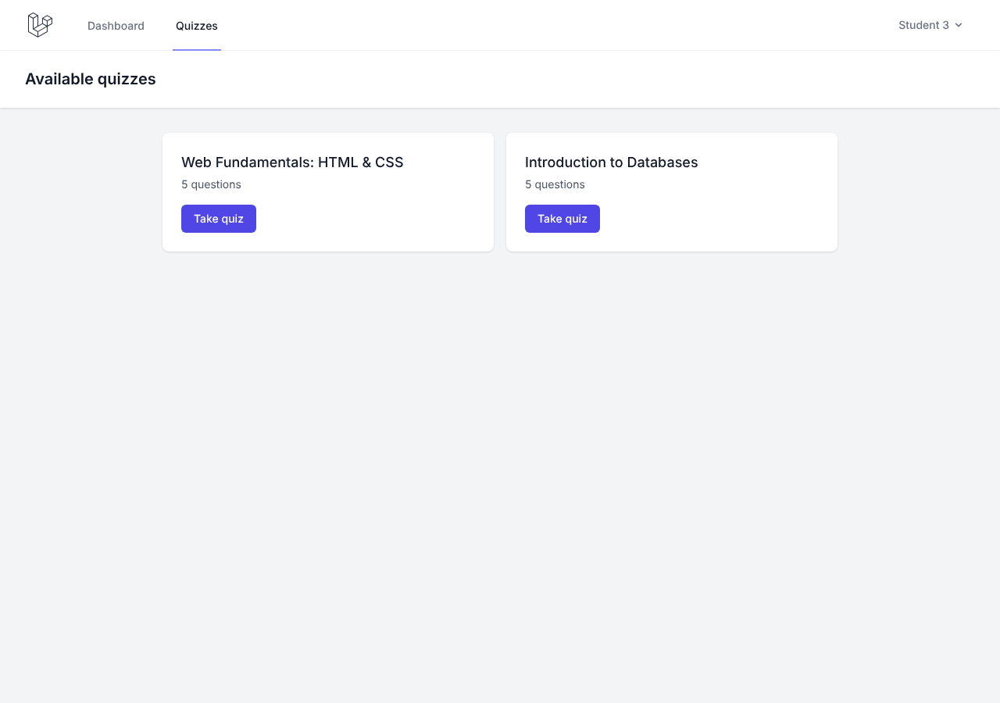

# Chapter 15 — Publishing a Quiz

> **Tasks:** T8–T9 · **Implements:** FR-5, FR-6 · **Ends at tag:** `chapter-15`
>
> **What you will learn:** how a single action can toggle state; how to guard a state change with a business rule; how one route can serve two roles with two different views; and why the student side of an application needs its own review.

## 15.1 Where we are

Lecturers can build complete quizzes, but students cannot see any of them. This chapter connects the two sides of the application. A lecturer *publishes* a quiz, and students see it. Draft quizzes stay hidden.

## 15.2 T8 — Publish and unpublish

> **T8** Publish/unpublish toggle with status badge; block publishing a quiz with no questions. *Verify: empty quiz won't publish; badge flips between draft and published.*

Prompt: "Complete task T8." This is a small task: one controller method, one route, one button. Here is the method from the validation build:

```php
public function publish(Quiz $quiz)
{
    Gate::authorize('manage', $quiz);

    if ($quiz->status === 'draft' && $quiz->questions()->count() === 0) {
        return redirect()->route('quizzes.show', $quiz)
            ->with('error', 'Add at least one question before publishing.');
    }

    $quiz->update(['status' => $quiz->status === 'draft' ? 'published' : 'draft']);

    return redirect()->route('quizzes.show', $quiz)
        ->with('success', $quiz->status === 'published' ? 'Quiz published.' : 'Quiz unpublished.');
}
```

The shape from Chapter 13 again, with one addition. *Authorize* (the same `manage` policy). Then a **guard**: if the quiz is a draft with no questions, refuse with a message. Then *act*: flip the status. One method handles both directions, so one button labelled *Publish* or *Unpublish* covers both.

> **Concept box: guards express business rules.** The guard is FR-5's "only quizzes with at least 1 question can be published", written as code. Without it, a lecturer could publish an empty quiz, and a student would open it to find nothing to answer. Notice that the guard applies only when *publishing*: unpublishing an empty quiz is harmless, so it is allowed. When you review a guard, check both what it blocks and what it deliberately allows.

The route uses `PATCH`, the HTTP method for "change part of something." Forms in HTML can only send `GET` or `POST`, so the button's form includes `@method('PATCH')`, which Laravel reads to treat the request correctly. You will see this pattern for `DELETE` too.

### Verify

1. Create a new, empty quiz and click *Publish*. You should see a red message and the badge should stay *Draft*.
2. Add one question and click *Publish* again. The badge should turn green and read *Published*.
3. Click *Unpublish*. The badge returns to *Draft*.

Step 1 is the negative case; it proves the guard exists. Commit: `T8: publish toggle with empty-quiz guard`.

## 15.3 T9 — The student quiz list

> **T9** Student quiz list: published quizzes as cards with title and question count (the Take quiz button arrives with its page in T10). *Verify: student sees only published quizzes; draft quizzes invisible.*

T9 introduces something new: **one route serving two roles.** Both lecturers and students visit `/quizzes`, but they need different things. The validation build's `index` method, which you met in Chapter 2, branches on role:

```php
if ($request->user()->role === 'lecturer') {
    $quizzes = $request->user()->quizzes()->withCount('questions')->latest()->get();
    return view('quizzes.index', ['quizzes' => $quizzes]);
}

$quizzes = Quiz::where('status', 'published')->withCount('questions')->get();
return view('quizzes.student-index', ['quizzes' => $quizzes]);
```

Lecturers get their own quizzes in a table. Students get every published quiz, from any lecturer, as cards. The `where('status', 'published')` clause is the whole of FR-6's visibility rule. It is one condition, which makes it easy to review and easy to miss: if your agent's version lacks it, students will see drafts.

> **When the plan gets it wrong: the button with nowhere to go.** `design.md` shows each student card with a *Take quiz* button, and the original T9 asked for it. But the page that button opens is created in T10. A button added now would link to a route that does not exist, and Laravel refuses to render a page that names an undefined route — the whole student list would crash. This is the same ordering mistake as the Manage link in Chapter 13, and it was caught the same way. The corrected roadmap moves the button into T10, together with its destination.

Figure 15.1 shows the student list as it looks after T10, button included.



*Figure 15.1 — A student's view of the published quizzes (after T10 adds the Take quiz button)*

> **When the pipeline gets it wrong: the invisible button.** This is the page from Chapter 3's stale-CSS story. During the validation build, it first rendered with its grid collapsed and its *Take quiz* buttons invisible, because the CSS bundle predated the new classes. If a new page looks broken but its HTML is fine, rebuild the CSS. Appendix C has the full diagnosis.

### Verify with a draft and a published quiz

1. As the lecturer, make sure you have one published quiz and one draft quiz.
2. Log in as the student and visit `/quizzes`.
3. The published quiz should appear as a card with its question count. The draft should not appear at all.

Also check from the other direction: the student should still get 403 at `/quizzes/1` (the manage page) and `/quizzes/create`. T9 added a new view for students, and new views are where old permission rules sometimes slip.

Commit: `T9: student list of published quizzes`.

## 15.4 Checkpoint

> **Checkpoint — `chapter-15`.** Lecturers can publish and unpublish quizzes; empty quizzes cannot be published. Students see published quizzes from all lecturers, and never see drafts.
>
> ```bash
> git tag my-chapter-15
> ```
>
> To continue from the book's verified state: `git restore . && git switch -c from-ch15 chapter-15`.

Students can see quizzes but not yet take them. The next chapter is the heart of the application.
