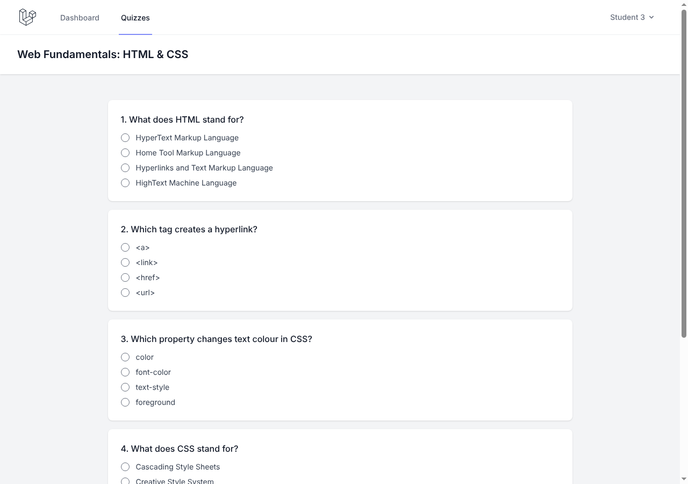

# Chapter 16 — Taking a Quiz

> **Tasks:** T10–T11 · **Implements:** FR-7, FR-8, FR-9 · **Ends at tag:** `chapter-16`
>
> **What you will learn:** how to gather several access conditions into one reusable guard; how to build validation rules dynamically from data; how a score is computed on the server, where students cannot alter it; and how the database's unique index backs up the one-attempt rule.

## 16.1 Where we are

Students can see published quizzes. This chapter lets them take one: answer every question, submit, and have the attempt scored and stored, exactly once. It is the most logic-heavy chapter in the build, and it contains the book's most important security point: **the score is calculated by the server, never trusted from the browser.**

## 16.2 T10 — The take page

> **T10** Take page: all questions with radio options, one submit; blocked for drafts, lecturers, and students who attempted; add the Take quiz button to the student quiz cards. *Verify: student clicks Take quiz and the page opens; lecturer gets 403.*

Prompt: "Complete task T10." Expect an `AttemptController`, the `Attempt` model and migration, two routes, the take view, and a button added to the student cards from Chapter 15. Check the migration against the ERD as usual, and look for one line in particular:

```php
$table->unique(['quiz_id', 'user_id']);
```

This is the unique index from Chapter 8's concept box: one row per student per quiz, enforced by the database. If it is missing, FR-9 rests on application code alone.

### Three conditions, one guard

Who may open the take page? A *student*, for a *published* quiz, which they have *not yet attempted*. Three conditions, and both the page (T10) and the submission (T11) need all three. The validation build gathered them into one private method:

```php
private function guardTakeable(Request $request, Quiz $quiz): void
{
    abort_unless($request->user()->role === 'student', 403);
    abort_unless($quiz->status === 'published', 403);
    abort_if(
        $quiz->attempts()->where('user_id', $request->user()->id)->exists(),
        403,
        'You have already taken this quiz.'
    );
}
```

Each line is one condition; each fails with 403. Both controller methods call `$this->guardTakeable($request, $quiz)` first. When you review, the question is whether *both* the page and the submission are guarded. Guarding only the page is a classic mistake: the form disappears, but a determined student can still send the request directly.

> **Concept box: a policy or a guard method?** Chapter 13 used a policy for quiz ownership. Here, the conditions concern the student's relationship to the quiz rather than ownership, and only one controller needs them, so a private method in that controller is a reasonable choice. Both approaches put each rule in one place. Either would pass review; what would fail review is the same check copied into two methods.

### The page

The take view lists every question in a card, each with four radio buttons named by question:

```html
<input type="radio" name="answers[{{ $question->id }}]" value="{{ $option->id }}">
```

Each question's radios share a name, so the student picks one per question. The submitted data maps question IDs to chosen option IDs: `answers[12] = 47`. Notice what is **not** in the form: no `is_correct` values, no hidden score. Look at the page source in your browser to confirm. If correct answers appeared anywhere in the HTML, any student could find them.



### Verify

Log in as a student and click *Take quiz* on a published quiz; the page should show all questions. Then try the doors:

- As the lecturer, visit the same `/quizzes/{id}/take` URL. Expect 403.
- Unpublish the quiz, then visit as the student. Expect 403.

Commit: `T10: take quiz page with access guard`.

## 16.3 T11 — Submitting, scoring, and the one-attempt rule

> **T11** Submit attempt: validate every question answered; compute and store the score (correct/total); enforce one attempt (unique index per ERD). *Verify: missing answer shows an error; known answers produce the expected stored score; second visit to the take page is blocked.*

### Validation built from data

How many answers must a submission contain? It depends on the quiz. A five-question quiz needs five, a ten-question quiz needs ten. So the validation rules cannot be written in advance; they are built from the quiz's questions:

```php
$rules = ['answers' => ['required', 'array']];
foreach ($quiz->questions as $question) {
    $rules["answers.{$question->id}"] = [
        'required',
        'integer',
        'in:'.$question->options->pluck('id')->implode(','),
    ];
}
```

For each question, the answer is *required* and must be *one of that question's own option IDs*. The second rule matters: without it, a student could submit an option ID belonging to a different question — perhaps one they know is correct. The `in:` rule closes that gap.

### Scoring on the server

```php
$score = 0;
foreach ($quiz->questions as $question) {
    $chosen  = (int) $validated['answers'][$question->id];
    $correct = $question->options->firstWhere('is_correct', true);
    if ($correct && $chosen === $correct->id) {
        $score++;
    }
}
```

For each question, find the correct option in the database and compare it with what the student chose. The score is then stored with the attempt. Everything the calculation depends on comes from the database; the browser supplies only the student's choices. This is the rule that makes the whole application trustworthy, and it is worth checking in every agent-written scoring function: **if the browser could change the score, the score means nothing.**

> **When the plan gets it wrong: inseparable tasks.** The original roadmap put scoring in T12, separate from submission in T11. The validation build showed this split was artificial. The `score` column in the ERD is required, so an attempt cannot be saved without a score. An agent doing T11 as written would have had to store a placeholder score of zero and then fix it in T12. Scoring was moved into T11, and T12 now handles only *displaying* the score. When two tasks keep reaching into each other's work, merge them.

### Verify

You need to know the correct answers. As the lecturer, look at the manage page, where they are marked in green.

1. As the student, open the quiz and submit with one question unanswered. The page should return with a message and keep your other answers.
2. Answer all questions, choosing correctly on a known number of them, and submit.
3. Check the stored score:

   ```bash
   docker compose exec app php artisan tinker --execute="echo App\Models\Attempt::latest()->first()->score;"
   ```

   It should equal the number you answered correctly.
4. Visit the take page again. Expect 403 with "You have already taken this quiz."

At this point the student is redirected to the quiz list after submitting, but nothing yet tells them their score. That is the next chapter.

Commit: `T11: submit attempt with validation, scoring, one-attempt rule`.

## 16.4 Checkpoint

> **Checkpoint — `chapter-16`.** Students can take a published quiz once. Every question must be answered. The score is computed on the server and stored. Lecturers, draft quizzes, and repeat attempts are all refused. `php artisan test` should still pass.
>
> ```bash
> git tag my-chapter-16
> ```
>
> To continue from the book's verified state: `git restore . && git switch -c from-ch16 chapter-16`.

The application now works end to end, but its results are hidden in the database. The final build chapter brings them into view.
