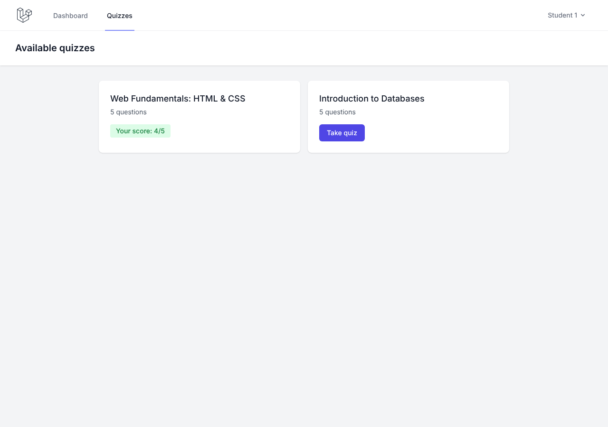
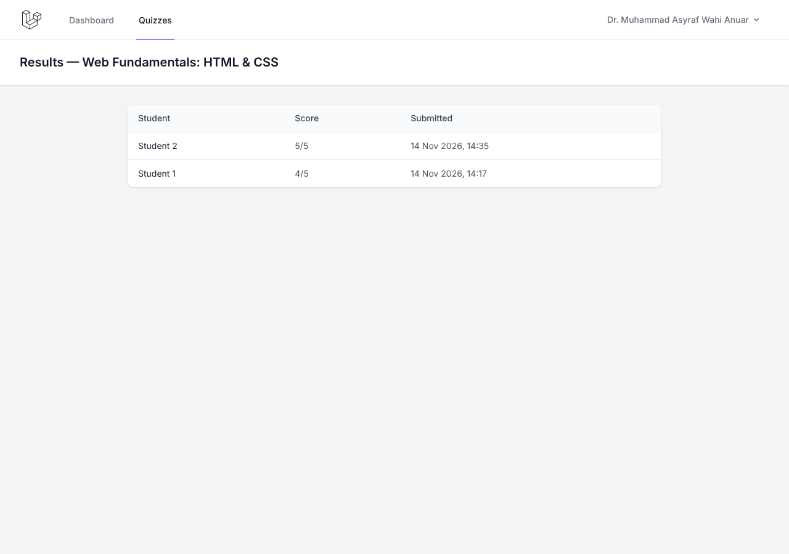

# Chapter 17 — Scoring and Results

> **Tasks:** T12–T14 · **Implements:** FR-8, FR-10, and the seeding requirement · **Ends at tag:** `chapter-17`
>
> **What you will learn:** how flash messages carry a result across a redirect; how to load related data efficiently for a list; how a seeder turns an empty application into a demonstration; and how to confirm the whole build from a clean start.

## 17.1 Where we are

Attempts are scored and stored, but nobody can see the scores. This chapter finishes the application: students see their results, lecturers see everyone's, and a seeder fills the database with a believable classroom so the app can be demonstrated in seconds.

## 17.2 T12 — Showing the student their score

> **T12** Show the result to the student: flash "You scored X/Y" after submission; the student quiz list shows the score instead of the Take quiz button. *Verify: after submitting, the flash appears and the list shows the score.*

### Flash messages

After submission, the student is redirected to the quiz list. A redirect is a new page request, so how does the result travel with it? A **flash message** — a value stored in the session for exactly one request:

```php
return redirect()->route('quizzes.index')
    ->with('success', "You scored {$score}/{$quiz->questions->count()} on {$quiz->title}");
```

The list view displays `session('success')` in a green banner, as specified in `design.md`, so the message appears once and disappears on the next page load. You have been seeing flash messages since Chapter 13 ("Quiz created."); T12 just puts a score in one.

### The score on the card

The flash is gone on reload, so the score must also appear permanently. The controller fetches the student's scores in one query, keyed by quiz:

```php
$scores = $request->user()->attempts()->pluck('score', 'quiz_id');
```

and the card shows either the score or the button:

```blade
@if ($scores->has($quiz->id))
    <p class="... bg-green-100 text-green-700">Your score: {{ $scores[$quiz->id] }}/{{ $quiz->questions_count }}</p>
@else
    <a href="{{ route('quizzes.take', $quiz) }}" class="...">Take quiz</a>
@endif
```

> **Concept box: one query, not one per card.** A tempting implementation asks the database "has this student attempted this quiz?" inside the loop, once per card. With two quizzes that is harmless; with fifty it is fifty queries for one page. Fetching all of the student's scores once with `pluck` and checking a list in memory is the efficient pattern. When you review agent code that loops over records, look for database calls *inside* the loop. They are a common inefficiency in generated code, and asking the agent to "load this once before the loop" usually fixes them.



Verify: take a quiz as a fresh student. The green banner should show the score; reload, and the banner disappears but the card still shows *Your score*. Commit: `T12: show score to student`.

## 17.3 T13 — The lecturer's results page

> **T13** Lecturer results page per quiz: student name, score, submitted time; empty state. *Verify: table lists the attempt from T12.*

A route, a controller method, and a table view. The method from the validation build:

```php
public function results(Quiz $quiz)
{
    Gate::authorize('manage', $quiz);

    $quiz->loadCount('questions');
    $attempts = $quiz->attempts()->with('user')->latest('submitted_at')->get();

    return view('quizzes.results', ['quiz' => $quiz, 'attempts' => $attempts]);
}
```

The `manage` policy from Chapter 13 again: only the quiz's owner sees its results. `with('user')` is the relationship version of the previous concept box: it loads every attempt's student in one extra query, rather than one per table row. Results are newest first.

Check the empty state too. `design.md` specifies "No attempts yet" for a quiz nobody has taken, and agents routinely forget empty states unless told.



Verify: as the lecturer, open the results for the quiz your student took in T12. Their name, score, and submission time should appear. Open results for an untaken quiz: "No attempts yet." As a student, visit any `/quizzes/{id}/results` URL: 403. Commit: `T13: lecturer results page`.

## 17.4 T14 — The demo seeder

> **T14** `DatabaseSeeder` per Architecture.md (1 lecturer, 5 students, 2 quizzes × 5 questions). *Verify: fresh `migrate --seed` yields a working demo; lecturer login shows 2 quizzes.*

A **seeder** is code that fills the database with data. EduQuiz's creates a lecturer, five students (all with the password `password`), and two published quizzes on topics an IMS566 class would recognise: web fundamentals and databases. The validation build's seeder stores the quiz content as plain arrays, which makes it easy to read and to replace with your own questions:

```php
'Web Fundamentals: HTML & CSS' => [
    ['What does HTML stand for?', ['HyperText Markup Language', 'Home Tool Markup Language',
      'Hyperlinks and Text Markup Language', 'HighText Machine Language'], 0],
    ['Which tag creates a hyperlink?', ['<a>', '<link>', '<href>', '<url>'], 0],
    // ...
],
```

Each entry is a question, its four options, and the index of the correct one. Change the strings and you have a demo for your own subject.

> **A seeder is a fixture, not a backup.** `migrate:fresh` **deletes every table** before rebuilding, and the seeder then fills the empty database. Never run them against a database holding real student results. In Chapter 19 you will deploy without seeding.

Verify from a clean start:

```bash
docker compose exec app php artisan migrate:fresh --seed
```

Log in as `lecturer@example.com` with password `password`. You should see two published quizzes with five questions each. Log in as `student1@example.com`, and both quizzes should be available to take. Commit: `T14: demo data seeder`.

## 17.5 The final verification

The build is complete. Before tagging, run the whole suite one last time:

```bash
docker compose exec app php artisan test
```

The validation build ended here with **36 tests and 122 assertions passing**: Breeze's 25 plus eleven acceptance tests, one for each verify line from T3 to T13. If you did not write acceptance tests, your number will be Breeze's 25, and that is fine; the manual verifications you performed task by task are the same checks.

If you would like the acceptance tests, the companion repository ships them as `tests/Feature/AcceptanceTest.php.example`. Copy the file to `tests/Feature/AcceptanceTest.php` and run the suite again. (The class inside is already named `AcceptanceTest` to match the file name.) They test behaviour, not code style, so they should pass against your application even though your code differs from the book's — which is Chapter 1's reproducibility promise, checked by machine.

## 17.6 Checkpoint

> **Checkpoint — `chapter-17`.** EduQuiz is complete. Lecturers create, publish, and review quizzes; students take each quiz once and see their scores; demo data loads in one command.
>
> ```bash
> git tag my-chapter-17
> git push mine my-build --tags
> ```
>
> To compare with the book's version: `git diff my-chapter-17 chapter-17 --stat` shows which files differ. Differences in wording or structure are expected; differences in behaviour are worth investigating.

## 17.7 Looking back at Part IV

Fourteen tasks, six chapters, and however many agent runs your retries took. Look at what you produced and what you did not. You did not type the controllers, migrations, models, or views. You *did* decide the schema, the rules, the access conditions, the order of work, and the definition of done for each piece — and you checked every one.

The validation build behind this book went the same way. Its failures were instructive and all were cheap: a test that needed a field, a task that asked too early, a link and a button that waited on later routes, a stylesheet that was out of date. None cost more than a few minutes, because every one was confined to a single small task and caught by a single verify line. That is the method working as designed.

Part V takes the application out of your laptop and into a classroom.
