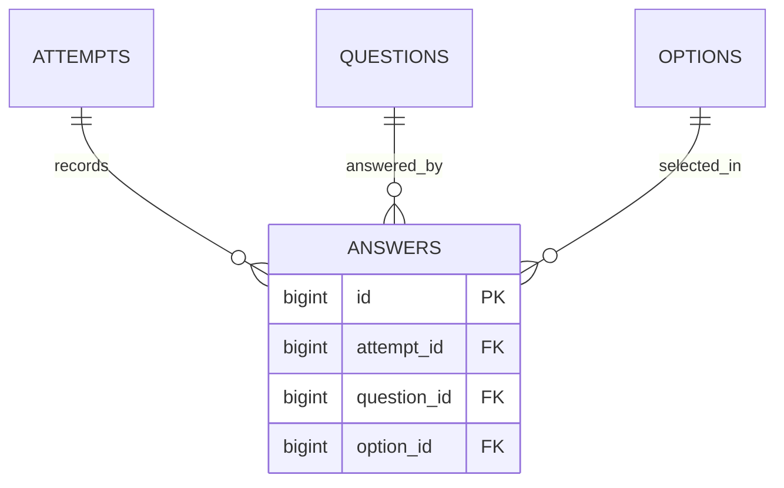

# Chapter 20 — Growing the App Yourself

> **What you will learn:** how to run the complete workflow without the book, from a change in requirements through to a verified, committed feature; how to change a schema safely after an application has data; and three guided extensions that each exercise a different part of the method.

## 20.1 The full loop, unaided

In Part IV, the five documents were written for you and each task arrived ready to prompt. In real work, change starts earlier: with a request. A colleague asks whether students can review which questions they got wrong. A student asks for a timer. You want true/false questions.

Every such change follows the same path through the documents, in the same order as Part III:

1. **PRD.md** — Is the feature in scope now? Move it from *Out of scope* into the functional requirements, numbered and testable.
2. **Architecture.md** — Does it change the schema or routes? Update the ERD and routes table.
3. **design.md** — Does it change what a page shows? Update the page's row.
4. **AGENTS.md** — Usually unchanged. Update it only if the feature exposes a new kind of agent misbehaviour.
5. **TODO.md** — Slice the feature into tasks with verify lines, appended after the last task.

Then build exactly as in Part IV: one task, review, verify, commit.

Commit the document changes *before* the first task, in their own commit: "Extend PRD and ERD for answer review." The repository history then reads as a design decision followed by its implementation, which is what it was.

## 20.2 Changing a schema that has data

Until now, every schema change happened before any real data existed, and `migrate:fresh` was harmless. After deployment that is no longer true. Real students' attempts sit in the production database.

The rule is simple: **never edit a migration that has already run in production. Add a new one.** A new migration describes a change — add a table, add a column — and `php artisan migrate --force` applies only the migrations that have not run yet, leaving existing data in place.

Add this to `AGENTS.md` before starting the exercises:

```markdown
12. **Never edit an existing migration.** Schema changes are new migration
    files only. New columns on existing tables must be nullable or have a
    default, so existing rows remain valid.
```

The second sentence matters. If you add a required column with no default to a table with rows in it, those existing rows have no valid value, and the migration fails in production.

## 20.3 Exercise A — Per-question answer review

> *Difficulty: moderate. Exercises: schema change, data model reasoning, results display.*

**The request.** "After a quiz, students want to see which questions they got wrong. Lecturers want to see which questions most students miss."

This is the feature cut from version one in Chapter 8, and you are now ready to see why it was the trickiest part of the original design.

**PRD.** Add requirements along these lines:

- **FR-12 Answer review (student):** after submitting, a student can view their attempt: each question, the option they chose, and whether it was correct. The correct answer is shown for incorrect questions.
- **FR-13 Question analysis (lecturer):** on the results page, each question shows the percentage of students who answered it correctly.

**Architecture.** The current schema stores only a total score, so the individual choices are lost at submission. A new table is needed:



Three foreign keys in one table. Think about each before writing the task:

- Why store `question_id` when it can be derived from `option_id`? (Hint: consider what happens if a lecturer deletes a question after students have answered it.)
- What should cascade on delete, and what should not? Should deleting a question delete the record of how students answered it?
- Attempts made *before* this feature have no answer rows. What should the review page show for them?

There is no single right answer to these questions. There is a requirement to answer them in the documents before the agent does.

**Suggested tasks.**

- **T18** `answers` migration and model; record each answer when an attempt is submitted (inside a transaction with the attempt). *Verify: submit an attempt with 5 questions; exactly 5 answer rows exist, each pointing at the chosen option.*
- **T19** Student review page for their own attempt. *Verify: review shows the chosen option per question and marks wrong ones; another student's attempt returns 403; an attempt from before T18 shows a "detailed review not available" message.*
- **T20** Per-question correct percentage on the lecturer results page. *Verify: with the seeded attempts, percentages match a hand calculation.*

## 20.4 Exercise B — A quiz timer

> *Difficulty: moderate. Exercises: adding a column with a default, server-side enforcement, deciding what the client may be trusted with.*

**The request.** "Quizzes should have an optional time limit."

**PRD.** A lecturer may set a time limit in minutes when creating or editing a quiz; no limit is the default. A student taking a timed quiz sees the deadline; a submission after the limit is not accepted.

**The design question.** A live countdown in the browser requires JavaScript, which the PRD's non-functional requirements limit to "where Laravel's defaults require it." You must decide whether to relax that rule for this feature — and update the PRD to say so — or to show the deadline as a clock time with no live countdown.

More importantly: **the browser's timer cannot be the enforcement.** Chapter 16's lesson was that the server computes the score because the browser cannot be trusted; the same holds for time. A student can stop a JavaScript timer, change the clock, or submit later from a saved page. The server must know when the attempt began and reject a late submission.

That means the server must record a *start time* when the take page opens, not only a `submitted_at` when it is submitted. Work out where that start time lives — a new `started_at` column on attempts means an attempt row exists before submission, which interacts with the one-attempt rule and the unique index. Resolve this in `Architecture.md` before writing tasks; it is the real difficulty of the exercise.

**Schema change.** Add `time_limit_minutes` to `quizzes` as a **nullable** integer — null meaning no limit — so existing quizzes remain valid (rule 12).

## 20.5 Exercise C — True/false questions

> *Difficulty: harder. Exercises: generalising a design, validation that varies by type, regression testing.*

**The request.** "Some questions are just true or false. Making lecturers type four options for them is silly."

**The design question.** FR-4 says every question has exactly four options. That rule is now wrong for some questions, and it is embedded in the validation, the add-question form, and the take page. Consider two designs:

- **Add a `type` column** to questions (`mcq` or `true_false`, defaulting to `mcq`). A true/false question has exactly two options, "True" and "False", created automatically.
- **Make the option count flexible**: questions have between two and four options, and true/false is simply a two-option question the lecturer types.

The first is more explicit and gives a cleaner form; the second is simpler in the schema but weaker as a specification. Choose one, record the choice and its reason in `Architecture.md`, and update FR-4.

**The regression risk.** This change alters code from T6, T10, and T11 — validation, form, and scoring. It is the first exercise where a new feature can break an old one. Your verify lines must therefore include old behaviour as well as new: *a four-option question still requires four options and one correct answer.* If you adopted the acceptance tests from Chapter 17, run the full suite after every task; this is exactly the situation they exist for.

## 20.6 Choosing your own

After the guided exercises, the remaining items in the PRD's out-of-scope list are open: points per question, question reordering, multiple attempts, categories. Each one exercises the same loop. Some suggestions for choosing:

- **Pick features your own students would use.** Requirements written for a real audience are better requirements.
- **Prefer one feature finished over three started.** A half-built feature with an incomplete document trail is harder to resume than a feature never begun.
- **Notice which documents each feature touches.** A feature that changes only `design.md` is cosmetic. One that changes the ERD is structural, and deserves more care in its tasks.

## 20.7 Beyond EduQuiz

The real subject of this book was never a quiz application. It was a way of working: deciding precisely what should exist, handing the work to an AI agent in pieces small enough to check, verifying each piece, and keeping a record that lets anyone reproduce the result.

That method does not depend on Laravel, on Tailwind, on Copilot, or on quizzes. It will outlast every tool named in these pages. When a new framework appears, you will need to learn to read it, as you learned to read Laravel in Chapter 2. When a better agent appears, it will slot into Chapter 4's middle layer. The five documents, the one-task loop, the verify line, the commit — those carry over unchanged.

Your next application begins the way this one did: with a blank `PRD.md` and the question *what, exactly, should exist?* The answer is still yours to write.
