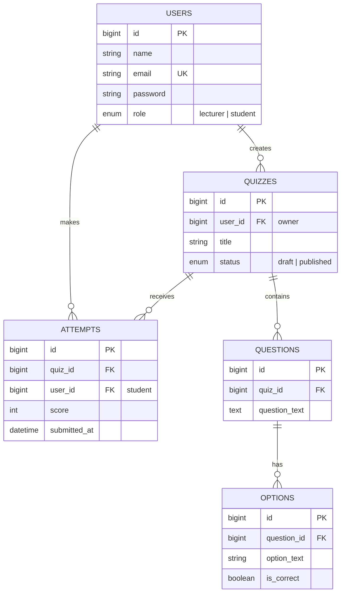

# Appendix D — The Five Documents

These are the complete documents that directed EduQuiz's build, version 1.1, incorporating the fixes from the validation build. They are reproduced exactly as they appear in the companion repository: `AGENTS.md` at the repository root, the other four in `docs/`. Each document's own headings are shown one level down.

## D.1 PRD.md

### Overview

EduQuiz is a web application where lecturers create multiple-choice quizzes and students take them online. A lecturer builds a quiz, adds questions, and publishes it; each student takes a published quiz once and receives an automatic score. The application is in English, responsive, and intended for classroom use.

### Users and roles

| Role | Can |
| --- | --- |
| Lecturer | Create, edit, delete and publish their own quizzes; add questions; view results per quiz |
| Student | See published quizzes; take each quiz once; see their own score |

A user picks their role at registration. A user has exactly one role.

### Functional requirements

- **FR-1 Authentication**: register (name, email, password, role), log in, log out
- **FR-2 Dashboards**: after login, lecturer and student land on role-appropriate dashboards
- **FR-3 Quiz management**: a lecturer creates, edits and deletes their own quizzes; a quiz has a title and a status (`draft` or `published`); new quizzes start as `draft`
- **FR-4 Questions**: a lecturer adds questions to their own quiz; each question has question text and exactly 4 options, exactly one marked correct; questions can be deleted
- **FR-5 Publishing**: a lecturer toggles a quiz between `draft` and `published`; only quizzes with at least 1 question can be published
- **FR-6 Quiz list (student)**: a student sees all published quizzes, each showing title, question count, and either a Take quiz button or their score
- **FR-7 Taking a quiz**: all questions on one page, one radio group of 4 options per question; every question must be answered before submission
- **FR-8 Scoring**: on submission the score (correct answers out of total) is computed, stored, and shown immediately
- **FR-9 One attempt**: a student who has attempted a quiz cannot take it again; the take page is blocked
- **FR-10 Results (lecturer)**: a lecturer sees, per quiz, a table of student name, score, and submission time
- **FR-11 Authorization**: lecturers cannot take quizzes; students cannot reach any quiz-management page; a lecturer can only manage their own quizzes

### Out of scope (v1)

Per-question answer review, timers, true/false and short-answer questions, points per question, question reordering, multiple attempts, categories or tags, email verification, password reset, file uploads, UI languages other than English.

### Non-functional

Responsive layout (usable on a phone), seeded demo data (1 lecturer, 5 students, 2 quizzes), all pages render without JavaScript except where Laravel's defaults require it.

## D.2 Architecture.md

### Stack (pinned)

| Layer | Choice | Notes |
| --- | --- | --- |
| Language | PHP 8.3 | fixed by the Docker image |
| Framework | Laravel 13 | exact version pinned in `composer.lock` |
| Database | MySQL 8.0 | service `db` in Docker Compose |
| Views | Blade templates only | no React, Vue, Livewire, Inertia, or API endpoints |
| CSS | Tailwind CSS via Vite | utilities only; no custom CSS files |
| Auth scaffolding | Laravel Breeze, Blade stack | provides register/login/logout views |
| Environment | Docker Compose (`app`, `db`, `node`) | readers never edit the compose file |

### Data model

The ERD below is the complete schema. No other tables or columns may be created (Laravel's own framework tables — sessions, cache, jobs — excepted).

All foreign keys cascade on delete. `attempts` has a unique index on (`quiz_id`, `user_id`) — the database enforces one attempt per student.

### Routes

| Method | URI | Name | Access |
| --- | --- | --- | --- |
| GET | /dashboard | dashboard | both (role-aware view) |
| GET | /quizzes | quizzes.index | lecturer: own quizzes; student: published quizzes |
| GET, POST | /quizzes/create, /quizzes | quizzes.create / .store | lecturer |
| GET | /quizzes/{quiz} | quizzes.show | lecturer (own): manage view; student: blocked |
| GET, PUT | /quizzes/{quiz}/edit, /quizzes/{quiz} | quizzes.edit / .update | lecturer, own quiz |
| DELETE | /quizzes/{quiz} | quizzes.destroy | lecturer, own quiz |
| PATCH | /quizzes/{quiz}/publish | quizzes.publish | lecturer, own quiz; toggles status |
| POST | /quizzes/{quiz}/questions | questions.store | lecturer, own quiz |
| DELETE | /questions/{question} | questions.destroy | lecturer, own quiz |
| GET | /quizzes/{quiz}/take | quizzes.take | student, published, not yet attempted |
| POST | /quizzes/{quiz}/attempts | attempts.store | student, published, not yet attempted |
| GET | /quizzes/{quiz}/results | quizzes.results | lecturer, own quiz |

### Conventions

- Controllers: `QuizController`, `QuestionController`, `AttemptController`; validation inline in controller methods
- Authorization: a `QuizPolicy` for lecturer actions (role + ownership); a private guard method in `AttemptController` for student access; no separate role middleware
- Models singular (`Quiz`, `Question`, `Option`, `Attempt`); tables plural; standard Laravel timestamps on all tables
- Laravel 13 marks mass-assignable fields with the `#[Fillable([...])]` attribute on the model class (older tutorials show a `$fillable` property; both work, the skeleton uses the attribute)
- Seeding: `DatabaseSeeder` creates 1 lecturer (`lecturer@example.com`), 5 students (`student1..5@example.com`), password `password`, and 2 sample quizzes with 5 questions each

## D.3 design.md

### Principles

Clean, academic, calm. Tailwind utility classes only — no custom CSS files, no component libraries, no icon packages. Every page must be readable on a phone (stack columns below `md:`).

### Palette and typography

| Use | Tailwind classes |
| --- | --- |
| Primary action | `bg-indigo-600 hover:bg-indigo-700 text-white` |
| Secondary action | `bg-white border border-gray-300 text-gray-700 hover:bg-gray-50` |
| Danger action | `bg-red-600 hover:bg-red-700 text-white` |
| Page background | `bg-gray-100` |
| Card | `bg-white rounded-lg shadow p-6` |
| Badge: draft | `bg-gray-100 text-gray-700` |
| Badge: published | `bg-green-100 text-green-700` |
| Headings | `text-xl font-semibold text-gray-900` (page), `text-lg font-medium` (section) |

Buttons: `px-4 py-2 rounded-md text-sm font-medium`. Form inputs: `w-full rounded-md border-gray-300 focus:border-indigo-500 focus:ring-indigo-500`. Validation errors: `text-sm text-red-600` under the field. Flash messages: green banner (`bg-green-50 text-green-800 rounded-md p-4`) under the page heading.

### Layout

Top navbar (white, bottom border): app name "EduQuiz" left; nav links and the user's name + logout right. Content inside `max-w-4xl mx-auto px-4 py-8`. Every page: heading row (title left, primary action right where one exists), then content.

### Pages

| Page | Content |
| --- | --- |
| Login / Register | Breeze defaults, restyled only by the palette above; register adds a role select (Lecturer / Student) |
| Lecturer dashboard | Greeting, count of own quizzes, link to quiz list |
| Quiz list (lecturer) | Table: title, status badge, question count, created date, actions (Manage / Edit / Delete); "New quiz" primary button |
| Quiz form | One card: title field, save + cancel |
| Quiz manage page | Quiz title + status badge + publish/unpublish button; questions listed as numbered cards (text, 4 options, correct one marked); "Add question" form at the bottom: question text, 4 option fields, radio to mark the correct one |
| Student dashboard | Greeting, count of published quizzes available, link to quiz list |
| Quiz list (student) | Cards: title, question count, "Take quiz" primary button or score shown if attempted |
| Take quiz | Quiz title, numbered questions each in a card with 4 radio options, one submit button at the bottom |
| After submit | Redirect to student quiz list with flash: "You scored X/Y on ‹title›" |
| Results (lecturer) | Table: student name, score, submitted at; empty state: "No attempts yet" |

## D.4 AGENTS.md

### Context

You are building EduQuiz inside a prepared Docker environment. The requirements are in `docs/PRD.md`, the system design in `docs/Architecture.md`, the visual rules in `docs/design.md`, and the roadmap in `docs/TODO.md`. These documents are the single source of truth.

### Rules

1. **Do only the current task.** Implement exactly the TODO task you were given — nothing more. Do not add features, pages, or "improvements" the task does not ask for.
2. **No new dependencies.** Never add composer or npm packages unless the task names the package. Specifically: no Spatie packages, no Livewire, no component libraries.
3. **Blade and Tailwind only.** No JavaScript frameworks. No custom CSS files. Follow `docs/design.md` classes exactly.
4. **The schema is fixed.** Create only the tables and columns in Architecture.md's ERD. Never add a column, table, or migration the task does not call for.
5. **Validate and authorize.** Every form submission is validated; every quiz-management action checks ownership via `QuizPolicy`; role access follows Architecture.md's routes table.
6. **Small diffs.** Touch only the files the task requires. Never refactor, rename, or reformat unrelated code.
7. **Never touch the environment.** Do not edit `docker-compose.yml`, `.env`, or any file under `docker/`.
8. **Verify before finishing.** Run the migrations and load the affected pages (or run the app's tests if present) before reporting done.
9. **Report in a fixed format**: files created/changed, commands run, and one sentence telling a human how to verify in the browser (URL + what they should see).
10. **design.md describes the finished app.** Build only the part of a page the current task asks for, even where design.md shows more; later tasks complete it.
11. **Ask instead of guessing.** If the task is ambiguous or conflicts with any document, stop and ask — do not pick an interpretation silently.

### Commands

All commands run inside the app container: `docker compose exec app php artisan …`. Assets: the `node` service already runs `npm run dev`; do not restart it.

## D.5 TODO.md

One task = one agent run = one commit. Give the agent exactly one task, verify with the "Verify" line, commit, and move on. Tag at each chapter boundary.

> **Note:** `design.md` describes the *finished* app. Each task implements only its own slice; a page may stay incomplete until a later task fills it in.

### Chapter 12 — authentication and roles

- [ ] **T1** Install Laravel Breeze (Blade stack); run its install and migrations. *Verify: register, log in and log out at /login.*
- [ ] **T2** Add `role` enum (`lecturer`, `student`) to users via migration; add a role select to the registration form. *Verify: register one lecturer and one student; roles stored correctly, and `php artisan test` still passes (Breeze's registration test needs the new role field).*
- [ ] **T3** Role-aware dashboard: different welcome text and guidance per role (quiz counts arrive with later tasks). *Verify: both accounts see different dashboards.*

### Chapter 13 — quiz CRUD

- [ ] **T4** `Quiz` model, migration (per ERD), `QuizPolicy`, and quiz list page showing the lecturer's own quizzes. *Verify: lecturer sees an empty list; student is blocked from /quizzes/create.*
- [ ] **T5** Create, edit and delete quizzes (title only; status defaults to draft), plus a minimal manage page (title + status badge; questions arrive next chapter). *Verify: lecturer creates, renames, deletes a quiz; Manage opens without error; another lecturer's quiz returns 403.*

### Chapter 14 — questions and options

- [ ] **T6** `Question` and `Option` models + migrations (per ERD); add-question form on the quiz manage page (text, 4 options, radio marks the correct one) with validation. *Verify: add a question; exactly 4 options saved, one correct.*
- [ ] **T7** List questions on the manage page as numbered cards with the correct option marked; allow deleting a question. *Verify: two questions display in order; deleting removes its options too.*

### Chapter 15 — publishing

- [ ] **T8** Publish/unpublish toggle with status badge; block publishing a quiz with no questions. *Verify: empty quiz won't publish; badge flips between draft and published.*
- [ ] **T9** Student quiz list: published quizzes as cards with title and question count (the Take quiz button arrives with its page in T10). *Verify: student sees only published quizzes; draft quizzes invisible.*

### Chapter 16 — taking a quiz

- [ ] **T10** Take page: all questions with radio options, one submit; blocked for drafts, lecturers, and students who attempted; add the Take quiz button to the student quiz cards. *Verify: student clicks Take quiz and the page opens; lecturer gets 403.*
- [ ] **T11** Submit attempt: validate every question answered; compute and store the score (correct/total); enforce one attempt (unique index per ERD). *Verify: missing answer shows an error; known answers produce the expected stored score; second visit to the take page is blocked.*

### Chapter 17 — scoring and results

- [ ] **T12** Show the result to the student: flash "You scored X/Y" after submission; the student quiz list shows the score instead of the Take quiz button. *Verify: after submitting, the flash appears and the list shows the score.*
- [ ] **T13** Lecturer results page per quiz: student name, score, submitted time; empty state. *Verify: table lists the attempt from T12.*
- [ ] **T14** `DatabaseSeeder` per Architecture.md (1 lecturer, 5 students, 2 quizzes × 5 questions). *Verify: fresh `migrate --seed` yields a working demo; lecturer login shows 2 quizzes.*
