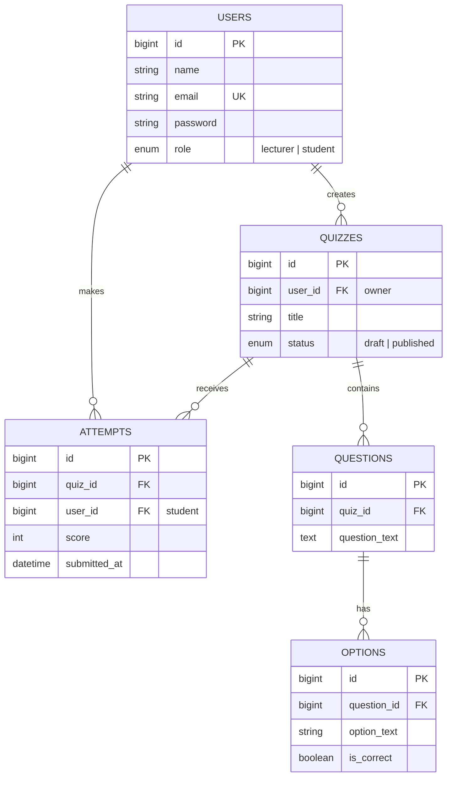

# Architecture.md — System Design: EduQuiz

## Stack (pinned)

| Layer | Choice | Notes |
| --- | --- | --- |
| Language | PHP 8.3 | fixed by the Docker image |
| Framework | Laravel 13 | exact version pinned in `composer.lock` |
| Database | MySQL 8.0 | service `db` in Docker Compose |
| Views | Blade templates only | no React, Vue, Livewire, Inertia, or API endpoints |
| CSS | Tailwind CSS via Vite | utilities only; no custom CSS files |
| Auth scaffolding | Laravel Breeze, Blade stack | provides register/login/logout views |
| Environment | Docker Compose (`app`, `db`, `node`) | readers never edit the compose file |

## Data model

The ERD below is the complete schema. No other tables or columns may be created (Laravel's own framework tables — sessions, cache, jobs — excepted).

All foreign keys cascade on delete. `attempts` has a unique index on (`quiz_id`, `user_id`) — the database enforces one attempt per student.

## Routes

| Method | URI | Name | Access |
| --- | --- | --- | --- |
| GET | /dashboard | dashboard | both (role-aware view) |
| GET | /quizzes | quizzes.index | lecturer: own quizzes; student: published quizzes |
| GET, POST | /quizzes/create, /quizzes | quizzes.create / .store | lecturer |
| GET | /quizzes/{quiz} | quizzes.show | lecturer (own): manage view; student: blocked |
| GET, PUT | /quizzes/{quiz}/edit, /quizzes/{quiz} | quizzes.edit / .update | lecturer, own quiz |
| DELETE | /quizzes/{quiz} | quizzes.destroy | lecturer, own quiz |
| PATCH | /quizzes/{quiz}/publish | quizzes.publish | lecturer, own quiz; toggles status |
| POST | /quizzes/{quiz}/questions | questions.store | lecturer, own quiz |
| DELETE | /questions/{question} | questions.destroy | lecturer, own quiz |
| GET | /quizzes/{quiz}/take | quizzes.take | student, published, not yet attempted |
| POST | /quizzes/{quiz}/attempts | attempts.store | student, published, not yet attempted |
| GET | /quizzes/{quiz}/results | quizzes.results | lecturer, own quiz |

## Conventions

- Controllers: `QuizController`, `QuestionController`, `AttemptController`; validation inline in controller methods
- Authorization: a `QuizPolicy` for lecturer actions (role + ownership); a private guard method in `AttemptController` for student access; no separate role middleware
- Models singular (`Quiz`, `Question`, `Option`, `Attempt`); tables plural; standard Laravel timestamps on all tables
- Laravel 13 marks mass-assignable fields with the `#[Fillable([...])]` attribute on the model class (older tutorials show a `$fillable` property; both work, the skeleton uses the attribute)
- Seeding: `DatabaseSeeder` creates 1 lecturer (`lecturer@example.com`), 5 students (`student1..5@example.com`), password `password`, and 2 sample quizzes with 5 questions each
